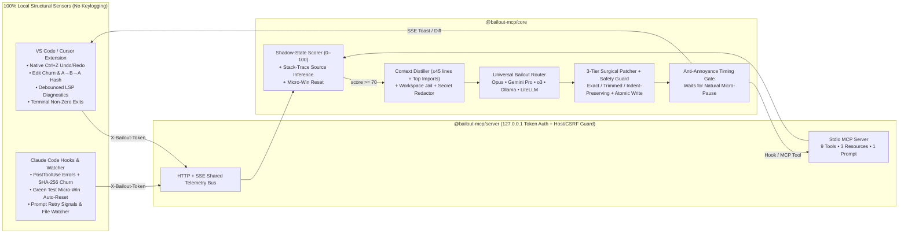

<div align="center">

# 🛟 BailoutMCP

### Shadow-State Frustration Detector & Silent Pre-Solved Heavy-Model Bailout Trigger

**Stop waiting until you're furious to switch models.**  
BailoutMCP detects when you (or a fast coding model) are silently trapped in an undo/oscillation/error loop, quietly escalates a secret-redacted micro-context to a frontier reasoning model, validates the surgical diff, and offers it **only during a natural micro-pause**.

[](https://github.com/Sunil56224972/BailoutMCP/actions/workflows/ci.yml)
[](LICENSE)
[](https://nodejs.org)
[](https://www.typescriptlang.org/)
[](https://modelcontextprotocol.io)

[Why BailoutMCP](#-the-problem-nobody-solved) •
[Architecture](#-architecture) •
[Quick Start](#-quick-start) •
[Providers](#-supported-heavy-model-providers) •
[MCP Reference](#-mcp-tools-resources--prompts) •
[Security Model](#-security--privacy-model)

</div>

---

## 🔥 The Problem Nobody Solved

Every developer using AI coding assistants hits the exact same wall every day:

1. You run a fast, affordable model (like Sonnet, Flash, Haiku, or a local model) to preserve speed and quota.
2. You hit a tricky state, concurrency, or type bug. You spend **10+ minutes on the same file** — spamming `Ctrl+Z`, oscillating `A → B → A` on the same lines, hitting the same compiler/test error 4 times, while the lightweight model patches symptoms in circles.
3. **The AI has zero clue you're stuck** until you angrily type *"this still doesn't work, stop guessing!"* — and then you have to manually switch to Opus / Gemini Pro / o3 and re-explain everything from scratch.

**BailoutMCP closes that loop silently in the background:**

> *"Stuck on `CartCounter.tsx`? Escalated to `claude-opus-4-6` and validated a 1-line fix (94% confidence): 'Use functional React state updater to fix stale closure'. Review diff?"*

- **100% Real Data & Real Models:** Zero fake/mock analyzers, zero hardcoded fallbacks. If no real model provider is configured, BailoutMCP honestly reports `routerReady: false` while still offering 100% local secret-redacted loop dossiers via `preview_dossier`.
- **Zero-Clippy Anti-Annoyance Gate:** Never pops up mid-keystroke. Waits silently for a natural micro-pause (`>= 3.5s` idle), auto-invalidates if you solve the bug yourself (**Micro-Win reset**) or if the file drifts externally, and backs off exponentially (`1x → 2x → 4x`) whenever dismissed.
- **Privacy-First & Hardened:** Raw keystrokes are never logged or transmitted. Sensitive files (`.env*`, keys, `.ssh`, `.aws`, DBs) are strictly blocked, and secrets are scrubbed before any code snippet leaves your machine.

---

## ⚡ How It Differs From Existing Tools

| Capability | Regex Frustration Checks | Proxy Stall Routers (LiteLLM / Advisor) | **BailoutMCP** |
| :--- | :---: | :---: | :---: |
| Detects frustration **before** you type an angry prompt | ❌ | ❌ | ✅ |
| Tracks native `Ctrl+Z` undo bursts & `A→B→A` edit oscillation | ❌ | ❌ | ✅ |
| Bridges **IDE behavioral signals** (VS Code/Cursor) with **CLI agents** (Claude Code / Antigravity) | ❌ | ❌ | ✅ |
| Multi-language stack-trace source inference (TS/JS, Python, Rust, Next.js routes; skips `node_modules`) | ❌ | ❌ | ✅ |
| Silently **pre-solves** & validates exact surgical diff (line-prefix & indentation resilient) | ❌ | ❌ | ✅ |
| **Natural-pause timing gate** (never interrupts mid-typing) | ❌ | ❌ | ✅ |
| **Micro-Win reset** (auto-clears friction & discards stale bailout when tests/errors turn green) | ❌ | ❌ | ✅ |
| **Zero-API offline dossier mode** (`preview_dossier` / `bailout-mcp preview`) | ❌ | ❌ | ✅ |
| Cross-provider heavy routing (Opus, Gemini Pro, o3, OpenRouter, Ollama, LiteLLM) | ❌ | Partial | ✅ |

---

## 🏗 Architecture



### Monorepo Layout

| Package / Path | Purpose |
| :--- | :--- |
| [`packages/core`](packages/core) | Zero-dependency TypeScript core: Shadow-State scorer, multi-language stack-trace source resolver, error signature normalizer, secret redactor, security jail, import-aware context distiller, universal model router, 3-tier surgical patcher, and pause timing gate |
| [`packages/mcp-server`](packages/mcp-server) | Stdio MCP server (`@modelcontextprotocol/sdk` with 9 tools), hardened `127.0.0.1` HTTP/SSE bridge daemon, workspace churn watcher, and `selftest`, `doctor`, `preview`, `escalate`, `status`, and `init` CLI commands |
| [`packages/vscode-extension`](packages/vscode-extension) | Thin VS Code / Cursor companion extension with calm Status Bar HUD, native side-by-side `vscode.diff` viewer, ambiguity-guarded matching, and `Ctrl+Z`-undoable 1-click `WorkspaceEdit` apply |
| [`hooks/claude-code`](hooks/claude-code) | Non-blocking `PostToolUse` & `UserPromptSubmit` hooks that track `A→B→A` edit oscillation hashes, auto-reset on green test runs, and inject deduplicated pre-solved rescues into Claude Code |
| [`skills/bailout-detector`](skills/bailout-detector/SKILL.md) | Agent Skill (`SKILL.md` + [`references/mcp-tools-reference.md`](skills/bailout-detector/references/mcp-tools-reference.md)) auto-discovered via [`.agents/skills.json`](.agents/skills.json) |

---

## 🚀 Quick Start

### 1. Clone, Install, Build & Verify

```bash
git clone https://github.com/Sunil56224972/BailoutMCP.git
cd BailoutMCP
pnpm install
pnpm run build
pnpm run typecheck
pnpm run test
node packages/mcp-server/dist/src/cli.js selftest
```

### 2. Configure Your Real Heavy-Model Provider

Copy `.env.example` to `.env` (in your workspace root or `~/.bailout-mcp/.env`, customizable via `BAILOUT_HOME`) and add **at least one** real provider:

```bash
cp .env.example .env
```

Example `.env` (Anthropic Opus primary, Gemini Pro fallback):

```dotenv
BAILOUT_PROVIDER=anthropic
BAILOUT_FALLBACK_PROVIDERS=gemini
ANTHROPIC_API_KEY=sk-ant-...
GEMINI_API_KEY=AIza...
```

Verify provider readiness & security configuration:

```bash
pnpm run doctor
```

### 3. Connect BailoutMCP to Claude Code / Cursor / Windsurf / Antigravity

Generate your local `.bailout.json` and exact MCP JSON snippet:

```bash
node packages/mcp-server/dist/src/cli.js init
```

Add to your MCP client configuration:

```json
{
  "mcpServers": {
    "bailout": {
      "command": "node",
      "args": ["/ABSOLUTE/PATH/TO/BailoutMCP/packages/mcp-server/dist/src/cli.js"],
      "env": {
        "BAILOUT_PROVIDER": "anthropic",
        "ANTHROPIC_API_KEY": "${ANTHROPIC_API_KEY}"
      }
    }
  }
}
```

> When the MCP server starts, it automatically connects to an existing local bridge or starts one on `127.0.0.1:47821` (with ephemeral port fallback on collision) so VS Code, Cursor, Antigravity, and Claude Code hooks share the exact same live Shadow-State.

### 4. Enable the VS Code / Cursor Companion Extension (Optional)

1. Open `packages/vscode-extension` in VS Code or Cursor and press `F5` (or build a `.vsix` package).
2. It auto-discovers `~/.bailout-mcp/bridge.json` and shows a subtle Status Bar pill:
   - `Flow (0)` — calm coding (long dwell without errors never triggers false alarms)
   - `Shadow: 58/100` — elevated undo/error friction
   - `Bailout Solving (78)` — silently running heavy reasoning model in background
   - `Bailout Ready (94%)` — validated diff waiting cleanly for a natural pause or click

### 5. Enable Agent Skill & Claude Code Hooks (Optional)

- **Antigravity:** Automatically discovered in this workspace via [`.agents/skills.json`](.agents/skills.json).
- **Claude Code / Other Agents:** Merge [`hooks/claude-code/settings.snippet.json`](hooks/claude-code/settings.snippet.json) into `~/.claude/settings.json` and copy [`skills/bailout-detector`](skills/bailout-detector) into your skills directory.

### 6. CLI Mode (Zero IDE Extension Required)

```bash
# Run instant end-to-end self-test of scoring, stack inference, redaction, security & MCP boot
node packages/mcp-server/dist/src/cli.js selftest

# Run standalone local bridge daemon + file-save churn & oscillation watcher
node packages/mcp-server/dist/src/cli.js daemon --watch .

# Inspect live Shadow-State
node packages/mcp-server/dist/src/cli.js status

# Preview the secret-redacted local BailoutDossier (100% local, zero API calls)
node packages/mcp-server/dist/src/cli.js preview ./src/buggyFile.ts --error "TypeError: ..."

# Run an immediate secret-redacted heavy-model escalation on a stubborn file (add --apply to write)
node packages/mcp-server/dist/src/cli.js escalate ./src/buggyFile.ts --error "TypeError: ..."
```

---

## 🧠 Supported Heavy-Model Providers

| Provider (`BAILOUT_PROVIDER`) | Env / Config | Default Model | Notes |
| :--- | :--- | :--- | :--- |
| `anthropic` | `ANTHROPIC_API_KEY` | `claude-opus-4-6` | Native Messages API (multi-block text support) |
| `gemini` | `GEMINI_API_KEY` | `gemini-2.5-pro` | `x-goog-api-key` header + JSON schema mime + thinking-part filter |
| `openai` | `OPENAI_API_KEY` | `o3` | Auto-detects `o1`/`o3`/`o4` (`max_completion_tokens: 8192`, omits `temperature`) |
| `openrouter` | `OPENROUTER_API_KEY` | `anthropic/claude-opus-4.6` | Unified multi-model routing |
| `ollama` | `BAILOUT_OLLAMA_URL`, `BAILOUT_OLLAMA_MODEL` | `qwen2.5-coder:32b` | 100% local offline real reasoning LLM |
| `custom` | `BAILOUT_ROUTER_URL`, `BAILOUT_ROUTER_MODEL` | *(your router)* | Works with LiteLLM / custom proxies; sends `X-Bailout-Trigger: shadow-state`, `X-Bailout-Frustration-Score`, `X-Bailout-Original-Model` |

Set `BAILOUT_FALLBACK_PROVIDERS=gemini,openrouter` to enable automatic failover across providers.

---

## 🛠 MCP Tools, Resources & Prompts

### Tools (9 Tools)
| Tool | Description |
| :--- | :--- |
| `get_shadow_state` | Live frustration score (`0–100`), phase, provider readiness, primary hotspot, signal breakdown, timing gate status, and stats |
| `record_signal` | Ingest `undo_burst`, `edit_churn`, `file_dwell`, `diagnostic_error`, `terminal_error`, `agent_tool_error`, `prompt_abandoned`, or `error_resolved` (supports `workspaceRoot` stack-trace file inference) |
| `get_pending_bailout` | Retrieve silently pre-solved heavy-model fix, root cause, confidence, and unified diff |
| `trigger_bailout` | Explicitly distill a redacted dossier (with optional inline `errorMessage`, `attemptedFix`, `startLine`, `endLine`) and escalate to the configured heavy model |
| `preview_dossier` | Distill and inspect the secret-redacted local `BailoutDossier` (hotspot score, normalized error fingerprints, top-of-file imports, code window) **100% locally with zero API calls** |
| `accept_bailout` | Accept proposal (optionally applying the validated surgical patch atomically to disk) and clear friction |
| `dismiss_bailout` | Dismiss pending fix and apply exponential cooldown backoff (`1x → 2x → 4x`) |
| `reset_shadow_state` | Reset Shadow-State friction debt and stale proposals for a single file or the entire workspace session |
| `configure_bailout_router` | Safely tune runtime thresholds (`stuckThreshold`, `frictionThreshold`, `pauseGateMs`, `cooldownMs`, `minConfidence`, `autoSolve`) or switch between configured providers |

### Resources & Prompts
- `bailout://shadow-state` — Real-time Shadow-State snapshot JSON
- `bailout://pending-bailout` — Pre-solved heavy-model bailout proposal + unified diff
- `bailout://last-dossier` — Exact secret-redacted context window & top-of-file imports last distilled (full transparency)
- `present-bailout` — Prompt template for calm, 2-sentence + diff presentation

---

## 🔒 Security & Privacy Model

BailoutMCP is engineered for real professional codebases from day one:

| Threat Vector | Defense Implemented |
| :--- | :--- |
| **Keystroke Spyware Concerns** | Raw keystrokes are **never** recorded or sent. Sensors read only structural events (`TextDocumentChangeReason.Undo/Redo`, line ranges, non-reversible SHA-256 region hashes, debounced diagnostics, exit codes). |
| **Credential / Secret Leakage** | Sensitive files (`.env*`, `*.pem`, `*.key`, `id_rsa*`, `.ssh/*`, `.aws/*`, `.npmrc`, `credentials.json`, `service-account.json`, `bridge.json`, `*.sqlite`, OS system dirs) are strictly blocked. Automated redactor scrubs API keys (Anthropic, OpenAI, Google, OpenRouter, Stripe, GitHub, GitLab, PyPI, Slack, SendGrid, HF, npm, AWS `AKIA`/`ASIA`), URL query secrets, JWTs, Basic/Bearer auth, PEM blocks, and DB URI passwords before egress, and blocks `[REDACTED_*]` placeholders from ever overwriting real secrets on disk. |
| **Path Traversal & Symlink Escape** | Symlink-resolved `assertSafeWorkspacePath` enforces workspace boundaries on both dossier reads and atomic disk writes, honoring strict root locks from `BAILOUT_ALLOWED_ROOTS` in env or `.env`. |
| **Localhost DNS Rebinding & CSRF** | Bridge binds strictly to `127.0.0.1`, verifies a 48-hex-char random token (`0600`) using `crypto.timingSafeEqual` in `X-Bailout-Token` header only (URL query tokens rejected), validates strict `Host` headers (`403`), and rejects browser `Origin` headers (`403`). |
| **SSRF & Runtime Hijacking** | `validateEndpointUrl` blocks AWS/GCP metadata IPs (`169.254.169.254`, `metadata.google.internal`), RFC1918 private IPs, `0.0.0.0`, IPv6 link-local/ULA, embedded URL credentials, `file://`, and non-loopback plaintext `http://`. MCP/HTTP config calls cannot mutate API keys, `baseUrl`, or `allowedWorkspaceRoots`. |
| **Prompt Injection in Untrusted Repos** | Untrusted workspace code, imports, and logs are isolated inside per-request random nonce delimiters (`<UNTRUSTED_CODE_nonce>`). `validatePatchSafety` rejects oversized rewrites (`> 35` changed lines) and newly-introduced dangerous primitives (`eval()`, `new Function()`, `child_process`, `fs.rmSync`/`fs.promises.rm`, remote `import()`, piped shell downloads, encoded PowerShell). |
| **Runaway API Spend** | Single-flight solve lock, `AbortSignal.timeout(45s)`, minimum confidence filter (`>= 0.72`), hard hourly (`6/hr`) & daily (`25/day`) caps, and per-file cooldowns. |

---

## 📄 License

Released under the [MIT License](LICENSE).
